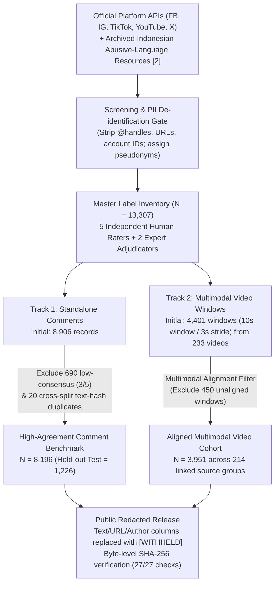

# Official Platform API Ingestion, De-identification, Temporal Windowing, and Public Redaction Protocol

> **Scope and Provenance Note:**  
> This document and its companion script ([`scripts/preprocessing/official_api_ingestion_and_windowing_reference.py`](../scripts/preprocessing/official_api_ingestion_and_windowing_reference.py)) and configuration ([`configs/ingestion_protocol_config.example.json`](../configs/ingestion_protocol_config.example.json)) provide the **reference preprocessing and ingestion specification** corresponding to **Section 3.1** of the manuscript (*"Evaluating Late Fusion under Fragmented Multimodal Evidence for Indonesian Cyberbullying Detection"*) and institutional administrative record **No. `010/DRPM/Univ-BD/IX/2026`** (dated 23 September 2026).  
> In accordance with [`data_release.md`](data_release.md) and [`RESEARCHER_DECLARATION_SCOPE.json`](../data/labels/v1_1_GoldAdjudicated/annotation/RESEARCHER_DECLARATION_SCOPE.json), this package documents the operational pipeline mechanics (official API query structure, PII de-identification, 10s/3s temporal segmentation, multimodal feature extraction, and `[WITHHELD]` public redaction). It is **not** presented as a raw contemporaneous acquisition log, contains **zero** credentials or personal identifiers, and does not redistribute restricted media.

---

## 1. End-to-End Corpus Flow (Section 3.1)



---

## 2. Stage-by-Stage Technical Specification

### Stage A — Official Platform API Query & Lexicon Interface
- **Collection Basis**: Official platform API endpoints (`YouTube Data API v3`, `TikTok Research API`, `Meta Graph API` for Facebook/Instagram, and `X API v2`) queried using Indonesian abusive-language and adolescent cyberbullying lexicon terms adapted from Ibrohim & Budi [2], combined with archived Indonesian abusive-language resources (where some historical source provenance is incomplete).
- **Credential Isolation**: API tokens are accessed strictly via runtime environment variables (`YOUTUBE_DATA_API_V3_KEY`, `TIKTOK_RESEARCH_API_BEARER_TOKEN`, `META_GRAPH_API_ACCESS_TOKEN`, `X_API_V2_BEARER_TOKEN`) and are never stored in code or configuration files.

### Stage B — De-identification & Pseudonymisation Gate
1. **Source-Group Pseudonymisation**:
   - Raw platform post/video identifiers are mapped to non-reversible group pseudonyms (`FB_<timestamp>_fb_<hash>`, `VID_<timestamp>`, `LEG_<timestamp>_<id>`) and observation IDs (`CB_MASTER_00001` to `CB_MASTER_13307`).
2. **Linguistic Normalization & PII Stripping** (`clean_and_deidentify_text`):
   - HTML entities are unescaped.
   - Objective cyberbullying/affective emojis (`🤡`, `🤮`, `💩`, `💀`, `👎`, `🖕`, `🤬`, `😡`, `😭`, `🤣`, etc.) are mapped to canonical Indonesian lexical tokens (`badut`, `muntah`, `kotoran`, `tengkorak`, `jempol bawah`, `jari tengah`, `mengumpat`, `marah`, `menangis`, `tertawa`).
   - Account mentions (`@[A-Za-z0-9_.]+`), web links (`https?://\S+|www\.\S+`), and video-editing watermark tokens (`filmora`, `capcut`, `kinemaster`, `inshot`, `vn editor`) are stripped.

### Stage C — Temporal Segmentation (10s Window / 3s Stride) & Multimodal Extraction
Each of the **233** restricted source videos is segmented deterministically without label or prediction input:
- **Windowing Rule**: Fixed window length $W = 10.0\text{ s}$ with stride $S = 3.0\text{ s}$ ($70\%$ temporal overlap), yielding **4,401** initial candidate segments (`Facebook: 828`, `Instagram: 1,420`, `TikTok: 754`, `YouTube: 750`, `X/Twitter: 649`).
- **Canonical Segment ID**: `{file_id}_s{index:05d}_{start_ms:09d}_{end_ms:09d}` (e.g., `FB_1791709216093_FACEBOOK_10215726872_s00000_000000000_000010000`).
- **Derived Modalities**:
  1. **Visual Keyframe**: 1 RGB frame ($224 \times 224$) extracted via `ffmpeg` at the exact window midpoint $t_{\text{mid}} = \text{round}(\text{start\_sec} + (\text{end\_sec} - \text{start\_sec}) / 2, 3)$.
  2. **Speech-to-Text (`stt_transcript`)**: Audio decoded at $16\text{ kHz}$ mono PCM (`pcm_s16le`) and transcribed with `faster-whisper` (`large-v3-turbo`, `language="id"`, `beam_size=1`, `vad_filter=True`, `condition_on_previous_text=False`).
  3. **Optical Character Recognition (`ocr_text`)**: Extracted from the midpoint keyframe via `EasyOCR` (`["id", "en"]`).
  4. **Acoustic Representation (`waveform16_v1`)**: 16-dimensional frame-level spectral and amplitude summary (`log10_rms_mean/std`, `absolute_peak/mean`, `zero_crossing_mean/std`, `spectral_centroid_mean/std`, `spectral_bandwidth_mean/std`, `spectral_rolloff85_mean/std`, `spectral_flatness_mean/std`, `spectral_flux_mean`, `audio_present`) computed over $400$-sample ($25\text{ ms}$) Hanning-windowed frames with $160$-sample ($10\text{ ms}$) hop and $512$-point RFFT.

### Stage D — Public `[WITHHELD]` Redaction & Checksum Manifest
Before public repository packaging (`Data FINAL/`), all text-bearing, path-bearing, and source-identifying columns (`raw_text_or_ocr`, `visual_keyframe_path`, `stt_audio_transcript`, `source_url`, `author_or_uploader`, `context_topic`, `collected_or_timestamp`, `emojis_extracted`, `frame_path`, `stt_transcript`, `ocr_text`) are replaced with `[WITHHELD]`, while preserving exact SHA-256 lineage in [`source_redaction_manifest.json`](source_redaction_manifest.json).

---

## 3. Verification Command

Run the built-in deterministic self-test (zero external network calls or credentials required):

```bash
python scripts/preprocessing/official_api_ingestion_and_windowing_reference.py --self-test
```
